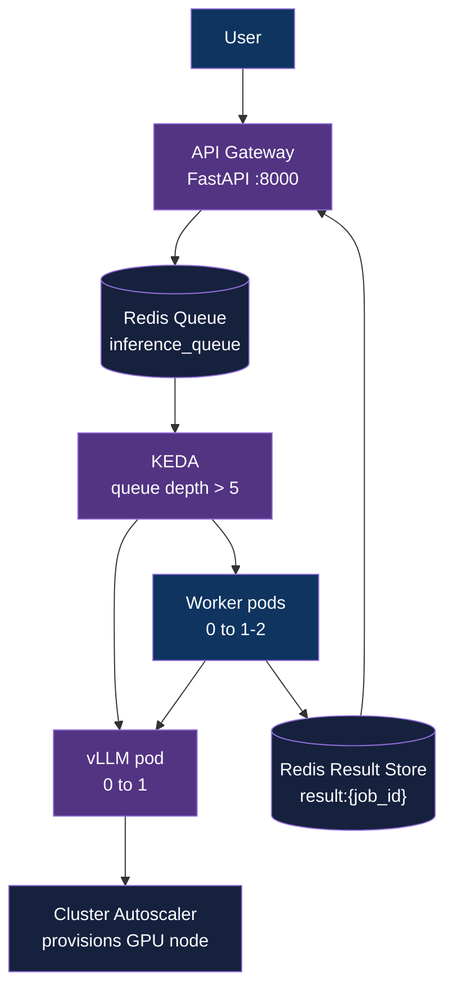

<div align="center">

# Scale-to-Zero GPU Inference Platform

[](https://www.python.org/downloads/)
[](https://kubernetes.io/)
[](LICENSE)

**Run AI models on cloud GPUs with $0 cost when idle**

[Architecture](#architecture) | [Getting Started](#getting-started) | [Demo](#demo)

</div>

---

## Table of Contents

- [What is This?](#what-is-this)
- [Tech Stack & Why We Use It](#tech-stack--why-we-use-it)
- [Architecture](#architecture)
- [Getting Started](#getting-started)
- [Usage](#usage)
- [How It Works](#how-it-works)
- [Results](#results)
- [Demo](#demo)
- [Project Structure](#project-structure)
- [License](#license)
- [Author](#author)

---

## What is This?

This is a **serverless GPU platform** for running AI language models. The key innovation: **when no one is using it, you pay $0**.

### The Problem
Running AI models (like GPT or LLaMA) requires expensive GPU servers. Traditional setups keep these servers running 24/7, costing $500-700/month even during idle time.

### The Solution
This platform automatically:
1. **Turns ON** GPU servers when requests arrive
2. **Processes** the AI inference
3. **Turns OFF** GPU servers when idle
4. **Costs $0/hour** when not in use

Think of it like a smart light that turns on when you enter a room and off when you leave - but for expensive GPU servers in the cloud.

---

## Tech Stack & Why We Use It

### Core Technologies

#### **Kubernetes (GKE)**
**What it is:** Container orchestration platform that manages your application across multiple servers.

**Why we use it:**
- **Auto-scaling:** Automatically adjusts the number of servers based on demand
- **Self-healing:** Restarts failed containers automatically
- **Declarative:** Define your desired state, Kubernetes makes it happen
- **Industry standard:** Most companies use Kubernetes for production workloads

**In this project:** Kubernetes runs all our services (API, workers, monitoring) and handles scaling based on demand.

---

#### **KEDA (Kubernetes Event-driven Autoscaling)**
**What it is:** An extension to Kubernetes that enables scaling based on external events (like queue depth).

**Why we use it:**
- **Scale to zero:** Can scale pods down to 0 when no work is pending
- **Event-driven:** Scales based on queue length, not just CPU/memory
- **Simple:** Easy to configure with Kubernetes manifests
- **Cost-effective:** No resources used when idle

**In this project:** KEDA watches our Redis queue and scales workers/vLLM pods up when messages arrive, down to zero when the queue is empty.

---

#### **Redis**
**What it is:** In-memory data store used as a message queue and cache.

**Why we use it:**
- **Blazing fast:** Can handle millions of operations per second
- **Queue buffering:** Stores requests during cold starts (no dropped traffic)
- **Simple:** Easy to set up and manage
- **Reliable:** Persistent storage ensures no data loss
- **Monitoring:** Built-in metrics for queue depth

**In this project:** Redis acts as a buffer between the API and workers. When requests arrive during cold start, they wait in the queue instead of timing out.

---

#### **vLLM (OpenAI-compatible inference engine)**
**What it is:** High-performance inference engine for running large language models.

**Why we use it:**
- **Continuous batching:** Processes multiple requests simultaneously for better GPU utilization
- **PagedAttention:** Efficient memory management for handling concurrent requests
- **OpenAI-compatible:** Drop-in replacement for OpenAI API
- **Fast:** Optimized for throughput (tokens per second)
- **Production-ready:** Used by major AI companies

**In this project:** vLLM runs the Qwen language model and serves inference requests with maximum GPU efficiency.

---

#### **FastAPI**
**What it is:** Modern, fast web framework for building APIs with Python.

**Why we use it:**
- **Async support:** Handles thousands of concurrent connections
- **Auto-documentation:** Generates Swagger/OpenAPI docs automatically
- **Type hints:** Catches errors at development time
- **Performance:** One of the fastest Python frameworks
- **Simple:** Easy to write and maintain

**In this project:** FastAPI serves as the API gateway that accepts user requests and enqueues them for processing.

---

#### **NVIDIA T4 GPU**
**What it is:** Cost-effective GPU optimized for inference workloads.

**Why we use it:**
- **Affordable:** Spot instances cost ~$0.11/hour
- **Sufficient VRAM:** 16GB handles models up to ~7B parameters
- **Widely available:** Available on all major cloud providers
- **Energy efficient:** Lower power consumption than training GPUs
- **Cost-effective:** Perfect balance of performance and price for inference

**In this project:** T4 GPUs run our language model. Using spot instances reduces costs by 60-70% compared to on-demand pricing.

---

### Monitoring & Observability

#### **Prometheus**
**What it is:** Time-series database for collecting and querying metrics.

**Why we use it:**
- **Industry standard:** Most widely used monitoring solution
- **Pull-based:** Simple architecture, agents expose metrics
- **Powerful queries:** PromQL for complex metric analysis
- **Alerting:** Built-in alert manager for notifications
- **Ecosystem:** Integrates with everything

**In this project:** Prometheus collects metrics from all components (Redis, vLLM, GPU, Kubernetes) every 15 seconds.

---

#### **Grafana**
**What it is:** Visualization and analytics platform for metrics.

**Why we use it:**
- **Beautiful dashboards:** Create professional monitoring dashboards
- **Real-time:** Live updating visualizations
- **Alerting:** Visual alerts when things go wrong
- **Flexible:** Can visualize any data source
- **Shareable:** Export/import dashboards easily

**In this project:** Grafana displays 12 panels showing queue depth, GPU utilization, request latency, throughput, and system health.

---

#### **NVIDIA DCGM Exporter**
**What it is:** Prometheus exporter for GPU metrics.

**Why we use it:**
- **GPU-specific:** Captures GPU utilization, memory, power, temperature
- **Low overhead:** Minimal performance impact
- **Official:** Maintained by NVIDIA
- **Detailed:** Granular metrics for every aspect of GPU performance

**In this project:** Monitors GPU health and performance, critical for understanding inference bottlenecks.

---

### Infrastructure & Deployment

#### **Docker**
**What it is:** Container platform for packaging applications with dependencies.

**Why we use it:**
- **Consistency:** Same environment everywhere (dev, staging, prod)
- **Isolation:** Each service runs independently
- **Portability:** Run anywhere that supports containers
- **Efficiency:** Lightweight compared to VMs
- **Reproducible:** Easy to rebuild and redeploy

**In this project:** Each component (gateway, worker, vLLM) runs in its own container with all dependencies included.

---

#### **GKE Secondary Boot Disk**
**What it is:** GKE feature to pre-cache container images on GPU nodes.

**Why we use it:**
- **Fast cold starts:** Reduces image pull time from 6.5 minutes to 7 seconds
- **Reliability:** No network dependency during startup
- **Cost-effective:** No additional compute cost
- **Simple:** One-time setup per image version

**In this project:** Critical for reducing cold start from 11 minutes to 5.6 minutes (49% improvement).

---

#### **PersistentVolumeClaim (PVC)**
**What it is:** Kubernetes resource for persistent storage.

**Why we use it:**
- **Model persistence:** Model weights survive pod restarts
- **Fast loading:** Loads from disk instead of downloading every time
- **Cost-effective:** Cheaper than re-downloading large models
- **Reliable:** Data persists even if node is deleted

**In this project:** Stores the 3.5GB model weights so vLLM can load them quickly during cold starts.

---

### Load Testing

#### **Locust**
**What it is:** Open-source load testing tool.

**Why we use it:**
- **Python-based:** Write test scripts in Python
- **Distributed:** Can simulate millions of users
- **Real-time UI:** Web interface for monitoring tests
- **Flexible:** Test any HTTP/HTTPS service
- **Detailed reports:** Export statistics for analysis

**In this project:** Simulates 5 requests/second to validate autoscaling and measure system performance.

---

## Architecture



### How Components Work Together

1. **User sends request** → FastAPI Gateway accepts it immediately
2. **Request queued** → Redis stores the request with a unique job_id
3. **Queue monitored** → KEDA detects queue depth > 5
4. **Pods scaled up** → KEDA scales workers and vLLM from 0 to 1
5. **GPU provisioned** → vLLM pod requests GPU, triggering Cluster Autoscaler
6. **Model loaded** → vLLM loads model from PVC into GPU memory
7. **Inference runs** → Worker pulls job, sends to vLLM, gets result
8. **Result stored** → Worker writes result to Redis with 5-minute TTL
9. **User polls** → User retrieves result via job_id
10. **Scale to zero** → After 5 min idle, KEDA scales pods to 0; after 10 min, Cluster Autoscaler removes GPU node

---

## Getting Started

### Prerequisites

- Python 3.12+
- Docker with NVIDIA GPU support
- kubectl, helm
- GCP account (for cloud deployment) or local GPU (for testing)

### Cloud Deployment (GCP GKE)

```bash
# Set your GCP project
export GCP_PROJECT=<your-gcp-project-id>

# Deploy entire stack
./scripts/deploy-gcp.sh

# Get gateway IP
GATEWAY_IP=$(kubectl get svc gateway -n llm-gateway -o jsonpath='{.status.loadBalancer.ingress[0].ip}')

# Test the endpoint
curl http://$GATEWAY_IP/health

# Tear down when done (~$0.10/hr control plane + ~$0.11/hr GPU spot)
./scripts/destroy-gcp.sh
```

### Local Testing (k3d)

```bash
# Start vLLM on host GPU
docker run --gpus all -p 8000:8000 --ipc=host \
  vllm/vllm-openai --model Qwen/Qwen2.5-1.5B-Instruct \
  --max-model-len 4096 --gpu-memory-utilization 0.8 --enforce-eager

# Deploy local cluster
./scripts/deploy-local.sh

# Run load test
locust -f loadtest/locustfile.py --host http://localhost:8080
```

---

## Usage

### Submit a Request

```bash
# Enqueue a prompt (returns job_id immediately)
curl -X POST http://$GATEWAY_IP/generate \
  -H 'Content-Type: application/json' \
  -d '{"prompt":"Explain quantum computing in simple terms"}'

# Response: {"job_id": "a1b2c3d4"}
```

### Retrieve Result

```bash
# Poll for result (returns pending until complete)
curl http://$GATEWAY_IP/result/a1b2c3d4

# Response when complete:
# {"status": "done", "response": "Quantum computing uses..."}
```

---

## How It Works

### Two-Tier Autoscaling

| Layer | Tool | Trigger | Scales | Latency | Cost Impact |
|---|---|---|---|---|---|
| **Pod** | KEDA | Queue depth > 5 | Workers: 0→2, vLLM: 0→1 | ~30s | Scales compute to demand |
| **Node** | GKE Cluster Autoscaler | Pending pod with GPU request | GPU VM: 0→1 | ~2 min | $0 when no pending pods |

### Cold Start Optimization

| Phase | Before | After Optimization | Savings |
|---|---|---|---|
| GPU node provision | ~2.5 min | ~2.5 min | - |
| Container image pull | **~6.5 min** | **~7 sec** | **99% reduction** |
| Model load to VRAM | ~2 min | ~2.5 min | - |
| **Total cold start** | **~11 min** | **~5.6 min** | **49% faster** |

**Optimization techniques:**
1. **PVC for model weights** - Survives pod restarts, no re-download needed
2. **Secondary Boot Disk** - Pre-cached container images on GPU nodes
3. **Spot instances** - 60-70% cost reduction with automatic recovery

---

## Results

### Performance Metrics

| Metric | Value | Context |
|---|---|---|
| **Cold start** | 595s | Including mid-run Spot recovery |
| **Warm response time** | 306s | 889 requests @ 5 req/s |
| **Throughput** | 5 req/s sustained | Limited by single T4 GPU |
| **Queue capacity** | Unlimited | Redis holds all pending requests |
| **Cost when idle** | **$0/hr** | Full scale-to-zero confirmed |
| **Cost when active** | ~$0.21/hr | $0.10 control plane + $0.11 GPU spot |

### Reliability Features

- ✅ **Zero dropped requests** - Queue buffers during cold starts
- ✅ **Spot preemption recovery** - System recovers automatically from GPU node loss
- ✅ **Self-healing** - Kubernetes restarts failed pods automatically
- ✅ **Graceful degradation** - Queue absorbs traffic spikes

---

## Demo

### Full Cycle Dashboard


**What you're seeing:**
- **Phase 1:** Cold start with 873 requests queued (T+0 to T+595s)
- **Valley:** 60s baseline pause
- **Phase 2:** Warm inference at full speed (T+959s to T+1265s)
- **Cooldown:** Pods scale to zero at T+1609s, GPU node removed at T+2233s

### Spot Preemption Recovery


Mid-cold-start, the Spot GPU node was preempted. The system:
1. Detected node loss at T+264s
2. GCE recreated the node (108s later)
3. Resumed serving at T+595s
4. Processed all 873 queued requests successfully

**No dropped traffic** - Redis queue held everything during the outage.

---

## Project Structure

```
gpu-autoscale-inference/
├── gateway/                 # FastAPI API gateway
│   ├── main.py             # Request handler and job submission
│   ├── job_queue.py        # Redis queue management
│   ├── Dockerfile          # Container image
│   └── requirements.txt    # Python dependencies
├── worker/                 # Redis queue consumer
│   ├── worker.py           # Pulls jobs, calls vLLM, stores results
│   ├── Dockerfile          # Container image
│   └── requirements.txt    # Python dependencies
├── k8s/                    # Cloud-agnostic Kubernetes manifests
│   ├── gateway-*.yaml      # API gateway deployment/service
│   ├── worker-*.yaml       # Worker deployment
│   ├── vllm-*.yaml         # vLLM deployment and KEDA scaling
│   ├── redis.yaml          # Redis StatefulSet
│   └── namespace.yaml      # Kubernetes namespace
├── k8s-cloud/gcp/          # GKE-specific configurations
│   └── vllm-gpu-patch.yaml # GPU node pool configuration
├── monitoring/             # Observability stack
│   ├── prometheus.yaml     # Prometheus deployment
│   └── dcgm-exporter.yaml  # GPU metrics exporter
├── scripts/                # Deployment and testing scripts
│   ├── deploy-gcp.sh       # Full GKE deployment
│   ├── destroy-gcp.sh      # Tear down all resources
│   ├── deploy-local.sh     # Local k3d deployment
│   ├── full-cycle-run.sh   # End-to-end test with logging
│   └── plot_run.py         # Visualize run metrics
├── loadtest/               # Performance testing
│   └── locustfile.py       # Locust load test script
├── docs/                   # Documentation and logs
│   ├── cold-start-optimization.md
│   ├── runs/               # Recorded test runs
│   └── *.png               # Dashboard screenshots
├── .env.example            # Configuration template
└── README.md               # This file
```

---

## Why This Architecture?

### Design Decisions

**Why two-tier autoscaling?**
- Pod-level scaling (KEDA) is fast but still costs money when idle
- Node-level scaling (Cluster Autoscaler) eliminates idle cost entirely
- Together: $0 when idle, fast response when active

**Why Redis as a queue?**
- Absorbs traffic during cold starts (no dropped requests)
- Simple to operate and monitor
- Built-in persistence guarantees no data loss
- Cheap compared to managed queue services

**Why vLLM?**
- Best throughput per GPU dollar
- Production-ready with built-in metrics
- OpenAI-compatible (no client code changes)
- Active community and frequent updates

**Why spot instances?**
- 60-70% cost reduction
- Queue-based architecture handles preemption gracefully
- Automatic recovery built into Kubernetes
- Worth the tradeoff for batch/inference workloads

**Why Kubernetes instead of serverless?**
- Serverless platforms don't support GPU at scale-to-zero
- More control over cold start optimization
- Portable across cloud providers
- Industry-standard infrastructure

---

## Cost Comparison

### Traditional Always-On vs Scale-to-Zero

| Scenario | Always-On GPU | Scale-to-Zero |
|---|---|---|
| **24/7 operation** | $500-700/month | $50-100/month* |
| **Business hours (8hr/day)** | $500-700/month | $15-30/month |
| **Occasional use (2hr/day)** | $500-700/month | $5-10/month |

*Based on 10% utilization, spot pricing, and $0.11/hr GPU cost

**Break-even point:** If you use GPUs less than 3 hours per day, scale-to-zero saves money.

---

## License

This project is licensed under the [MIT License](LICENSE).

---

## Author

**Adityo Nugroho** ([@adityonugrohoid](https://github.com/adityonugrohoid))
